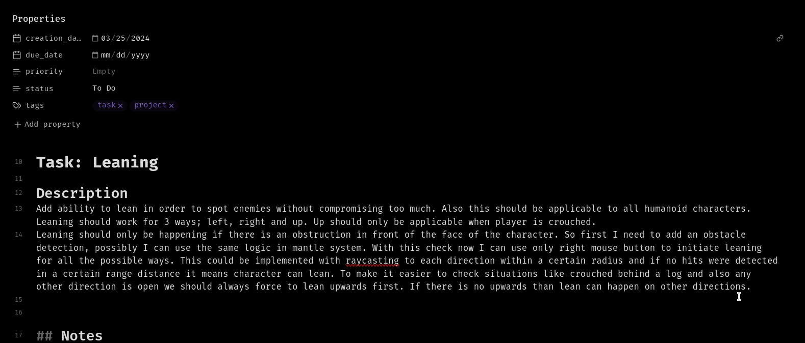
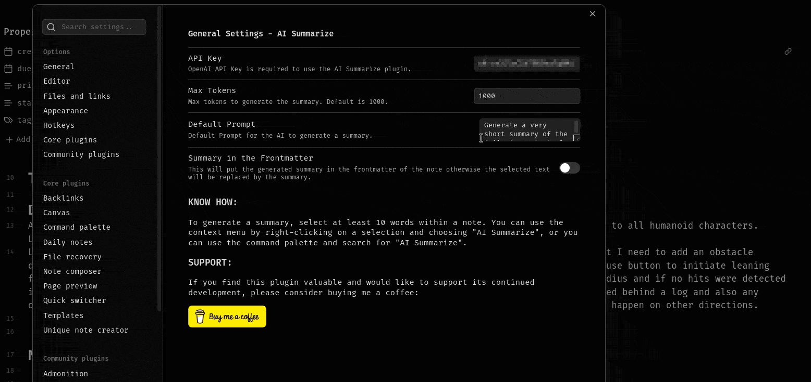

# Obsidian AI Summarize Plugin

An intelligent Obsidian plugin that uses OpenAI models to summarize notes, extract review material, surface open loops, and create folder-level digests. It keeps summarization at the center while adding practical Obsidian workflows such as frontmatter summaries, daily-note output, linked-note context, and project digests.

## Features

### Core Functionality

- **AI-powered summarization**: Generate summaries from selected text or the full active note.
- **Streaming responses**: See selection summaries appear in the editor as they generate.
- **Smart chunking**: Large selections are split into chunks and combined into a final summary.
- **Progress and cancellation**: Long-running operations show progress and can be cancelled.
- **Manual model refresh**: Refresh available OpenAI models only when you need to.

### Summary Presets

Use the right-click context menu to run one-off presets without changing your saved profile:

- **Summary**: Concise summary, detailed summary, bullet points, action items, study notes, meeting notes.
- **Review**: Review questions, flashcards, explain simply, what to remember.
- **Open loops**: Open loops, open questions, unresolved decisions, missing context.

### Flexible Output Destinations

- **Replace selection**: Replace selected text with the generated summary.
- **Insert below**: Add output below the selected text.
- **Frontmatter**: Add output to the note's YAML frontmatter under `summary`.
- **Append to current note**: Add the result to the active note.
- **Create new note**: Save generated output as a new note.
- **Append to daily note**: Send output to today's daily note.

### Folder Digests

Create digests from an entire folder of notes:

- **Project status**: Current state, progress, risks, blockers, and next steps.
- **Weekly digest**: Themes, updates, completed work, and open loops.
- **Research digest**: Findings, evidence, contradictions, and open questions.
- **Meeting digest**: Decisions, action items, owners, deadlines, and follow-ups.
- **Open loops digest**: Folder-level questions, blockers, missing context, and unresolved decisions.

You can launch a digest from the command palette or by right-clicking a folder in the file explorer.

### Link-Aware Full Note Summaries

When enabled, full-note summaries can include lightweight context from directly linked notes. The plugin prefers linked notes' `summary` frontmatter when available and falls back to short excerpts when needed.

### Advanced Configuration

- **Multiple profiles**: Save different combinations of model, prompt, max tokens, system instructions, output destination, and link-aware behavior.
- **Model selection**: Use GPT-4o, GPT-4.1, GPT-5, reasoning models, or another available OpenAI model.
- **Custom prompts**: Tailor summary behavior for different note types.
- **System instructions**: Define tone, style, language, or output format.
- **Token management**: Set custom output limits with model-aware input budgeting.

Inline summarization from menu:



Frontmatter summarization:



## Installation

### From Obsidian Community Plugins

1. Open Obsidian and navigate to **Settings** -> **Community plugins**.
2. Click **Browse** and search for **AI Summarize**.
3. Click **Install** and then **Enable**.
4. Configure your OpenAI API key in the plugin settings.

### Manual Installation

1. Download the latest release from the [GitHub releases page](https://github.com/RavenWits/obsidian-ai-summarize/releases).
2. Extract `main.js`, `manifest.json`, and `styles.css` to your vault's `.obsidian/plugins/ai-summarize/` directory.
3. Reload Obsidian.
4. Enable the plugin in **Settings** -> **Community plugins**.

## Usage

### Initial Setup

1. **Get an API key**: Sign up at [OpenAI](https://platform.openai.com/signup) and generate an API key.
2. **Configure the plugin**:
    - Go to **Settings** -> **AI Summarize**.
    - Enter your OpenAI API key.
    - Choose your preferred model or refresh the model list.
3. **Customize settings**:
    - Choose max tokens.
    - Customize the default prompt and system instructions.
    - Select the default output destination.
    - Create profiles for different workflows.

### Generating Summaries

**Method 1: Context menu**

1. Select text in your note, at least 30 words.
2. Right-click to open the context menu.
3. Click **AI summarize**.
4. Choose **Active profile summary** or one of the presets.

**Method 2: Command palette**

1. Select text in your note, at least 30 words.
2. Open the command palette with `Ctrl/Cmd + P`.
3. Run **AI Summarize: Summarize selection**.

**Method 3: Full note summary**

1. Open the note you want to summarize.
2. Run **AI Summarize: Summarize current note** from the command palette.
3. The result is written to your selected output destination.

### Creating Folder Digests

**From the command palette**

1. Run **AI Summarize: Create digest from folder**.
2. Choose a folder, digest type, date filter, max files, subfolder behavior, and destination.
3. Click **Create digest**.

**From the file explorer**

1. Right-click a folder.
2. Choose **Create AI digest**.
3. Confirm the digest options and destination.

### Cancelling Operations

Long-running AI operations show a progress notice with a **Cancel** button. You can also run **AI Summarize: Cancel current operation** from the command palette.

Starting a new AI operation cancels the previous in-progress run.

## Configuration

### Profile Management

Create multiple profiles for different summarization scenarios:

- **Meeting notes**: Bullet summaries, action items, and daily-note output.
- **Research notes**: Detailed summaries, review questions, and linked-note context.
- **Project notes**: Open loops, decisions, blockers, and folder digests.
- **Study notes**: Flashcards, review questions, and what-to-remember outputs.

**Creating a profile:**

1. Go to plugin settings.
2. Click **New profile**.
3. Configure model, max tokens, prompt, system instructions, destination, and link-aware behavior.
4. Name your profile.
5. Switch between profiles using the dropdown.

### Tips for Best Results

**Prompt engineering**

```text
Good: Summarize the following in 3-4 sentences focusing on key decisions and action items.
```

```text
Better: Create a concise summary highlighting: 1) main decisions made, 2) action items with owners, 3) open questions.
```

**System instructions**

- Specify language: `Always respond in English`.
- Define format: `Use concise markdown bullet points`.
- Set tone: `Use professional, academic language`.
- Add constraints: `Do not invent owners, deadlines, or decisions`.

### Notes on Large Inputs

When content is too large for the selected model:

- Selection summaries are chunked and synthesized into a final result.
- Folder digests summarize source notes first, then create a final digest.
- Link-aware summaries limit linked-note context so the active note remains the priority.

## Development

```bash
npm ci
npm run build
npm run lint
```

For watch mode during local testing:

```bash
npm run dev
```

`main.js` is generated by esbuild and ignored by git.

## Release Checklist

1. Run `npm run build`.
2. Run `npm run lint`.
3. Confirm `package.json`, `manifest.json`, `versions.json`, and the release tag use the same version.
4. Attach `main.js`, `manifest.json`, and `styles.css` to the GitHub release.

## Contributing

Contributions are welcome. Please test changes in a local Obsidian vault before opening a pull request.

## Issues and Support

Encountered a bug or have a feature request?

1. Check [existing issues](https://github.com/RavenWits/obsidian-ai-summarize/issues).
2. If not found, [create a new issue](https://github.com/RavenWits/obsidian-ai-summarize/issues/new).
3. Include your Obsidian version, plugin version, model used, steps to reproduce, and any error messages.

## License

This project is licensed under the [GPL-3.0 License](LICENSE).

## Support the Project

If you find this plugin valuable and want to support continued development:

[Buy me a coffee](https://www.buymeacoffee.com/ravenwits)

Other ways to support:

- Star the repository.
- Report bugs and suggest features.
- Improve documentation.
- Contribute code.
- Share the plugin with others.

## Author

**Alp Sariyer**

- Website: [alpsariyer.dev](https://www.alpsariyer.dev)
- GitHub: [@ravenwits](https://github.com/ravenwits)

## Acknowledgments

- Built with the [Obsidian API](https://github.com/obsidianmd/obsidian-api).
- Powered by [OpenAI](https://openai.com/).
- Inspired by the Obsidian community's need for practical AI-assisted note workflows.

---

<div align="center">

**Happy summarizing.**

_Made for the Obsidian community._

</div>
